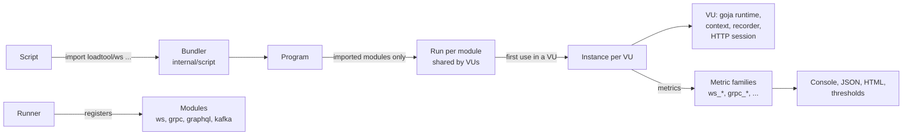
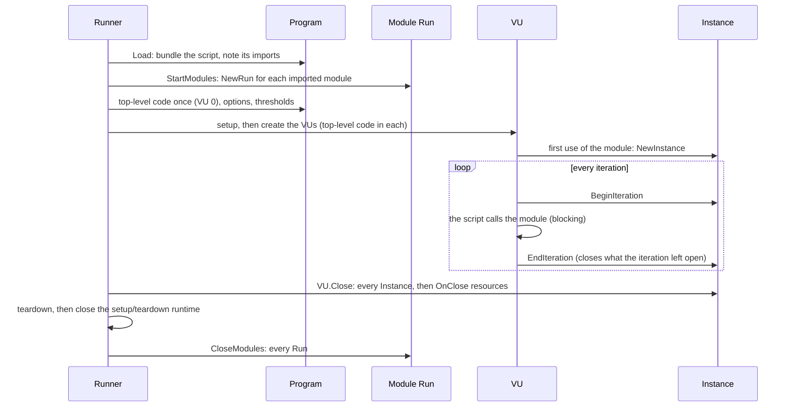

# The protocol system

How WebSocket, gRPC, GraphQL and Kafka plug into LoadTool's engine
(Phase 2). This page describes the design as built. The decisions behind
it, and the alternatives considered, are in ADR-014 to ADR-018
([index](../decisions/README.md)). Each protocol has its own ADR:
ADR-019 (WebSocket), ADR-020 (gRPC), ADR-021 (GraphQL) and ADR-022
(Kafka). For the script API, see the [protocol pages](../script-api.md#protocols).

## The shape

- **The engine stays protocol-agnostic.** The runner, the scenario
  engine and the VU loop know nothing about any protocol. Protocol code
  lives in `internal/protocols/<name>`. Each module sees the rest of
  LoadTool only through the small interfaces in `internal/protocol`.
- **HTTP is not a module.** It stays on its Phase 1 path (`internal/httpclient`),
  unchanged. GraphQL is a module built on that path (ADR-021).
- **Modules are compiled in.** The runner lists them explicitly
  (`internal/runner/modules.go`). There are no runtime plugins.

## The interfaces (`internal/protocol`)

| Interface | One per | Holds | Provided by |
|---|---|---|---|
| `Module` | protocol | Name, exports, metric definitions | The module package |
| `Run` | test run that imports the module | Shared, thread-safe state (for example parsed `.proto` descriptors) | `Module.NewRun` |
| `Instance` | VU that uses the module | That VU's state: clients, connections, open sockets | `Run.NewInstance` |
| `VU` | VU | What a module may use: the goja runtime, `__VU`, the current context and recorder, the VU's HTTP session, `Warn`, `OnClose` | `internal/script` |

A module's exports become a JavaScript module. `import ws from "loadtool/ws"`
is bundled as a small module that re-exports the properties of the VU's
module object. A capitalized export (such as `Client` or `Producer`) is a
class that scripts call with `new`. Modules may have aliases
(`loadtool/websocket` for `loadtool/ws`).

## Lifecycle

- **Runs start before any script code.** So top-level code may call a
  module that needs no network, such as `client.load(...)` for `.proto`
  files.
- **Instances are created lazily,** on a VU's first use of the module.
  Network calls are refused in top-level code: `VU.Context()` is nil
  there, and modules throw a clear error.
- **`EndIteration`** runs while the iteration's context is still set,
  so an instance can close what the script left open, such as a
  blocking-style WebSocket, with a warning.
- **Closing is ordered and bounded.** Once every VU goroutine has ended,
  the runner closes each VU (its instances, then its `OnClose`
  resources), then runs teardown, then closes the module runs. Each step
  has a 5 s deadline, and a close error is a warning, not a failure.

## State and ownership

| Protocol | Per VU | Shared by the run |
|---|---|---|
| HTTP | Cookie jar | One transport and connection pool (ADR-009) |
| GraphQL | Nothing of its own: it uses the VU's HTTP session | The HTTP transport |
| WebSocket | Open sockets (one per `connect`) | Nothing |
| gRPC | One connection per `grpc.Client` | Parsed descriptors |
| Kafka | One franz-go client per `Producer`/`Consumer` (and per configuration for the one-off calls) | Nothing |

No module state is shared between VUs unless the table says so, so one
VU's session, socket or client is never visible to another. The
end-to-end test (`internal/runner/mixed_test.go`) checks this at the
Kafka broker as well as in scripts.

## Cost when not used

A module a script does not import costs nothing:

- no `Run` is created, and its metric families are not registered;
- the VU's built-in module object gets properties only for the modules
  the script imports;
- VU state for modules (`vuModules`: instance slots and closers) is
  allocated only when the script imports one.

So an HTTP-only VU is the same size as in Phase 1. A test keeps the `VU`
struct within its 144-byte size class (`TestVUFitsItsSizeClass`), and
`BenchmarkVURetainedMemory` measures it with every module registered
(`benchmarks/results/2026-10-14-phase2/`).

## Concurrency

- **JavaScript runs only on the VU's goroutine,** and so does every call
  into a module. Calls block: `socket.receive()`, `client.invoke()` and
  `producer.produce()` return when the operation completes or times out.
  There is no event loop or Promise machinery (ADR-017).
- **Background goroutines are allowed in two forms:** joined before the
  call returns, or owned by a `Run` or `Instance` and stopped by its
  `Close`. An example of the second is a WebSocket reader, which hands
  messages to the VU over a channel. Such goroutines never touch goja or
  a recorder.
- **Cancellation** comes through `VU.Context()`. When a run is
  interrupted or `gracefulStop` runs out, every blocking call returns.

## Metrics

Each module declares metric families (`metrics.Def`: Trend, Counter or
Rate, ADR-015). They are registered when its run starts, recorded with
`protocol.Record`, and appear by name in the console summary, the JSON
summary, the HTML report and thresholds: `ws_*`, `grpc_*`, `graphql_*`
and `kafka_*`.

- **Calls cut short by the end of the test are not recorded,** so they
  neither count as failures nor fail thresholds.
- **Setup and teardown use a throwaway recorder,** so their calls are not
  part of the load metrics.

## Errors

Results carry `error` (a message) and `error_code`, normalized across
protocols (ADR-016): `dns`, `dial`, `tls`, `timeout`, `protocol`,
`server`, `closed` and `invalid`. `protocol.Classify` maps Go errors to
codes, and each module maps its own (gRPC statuses, Kafka broker errors).
Results never throw for a failed operation; scripts throw only for
misuse, such as calling the network in top-level code.

## Adding a protocol

1. Write an ADR for the protocol: its API, state ownership, metrics and
   errors.
2. Add a package `internal/protocols/<name>` that implements `Module`,
   `Run` and `Instance`, and test it in isolation with
   `internal/protocol/protocoltest`.
3. Register it in `internal/runner/modules.go`, and declare its API in
   `types/loadtool.d.ts`.
4. Add its metric prefix to the JSON schema's `patternProperties`.
5. Add examples (run by `scripts/smoke-examples.sh`), a page under
   `docs/protocols/`, and a benchmark.
